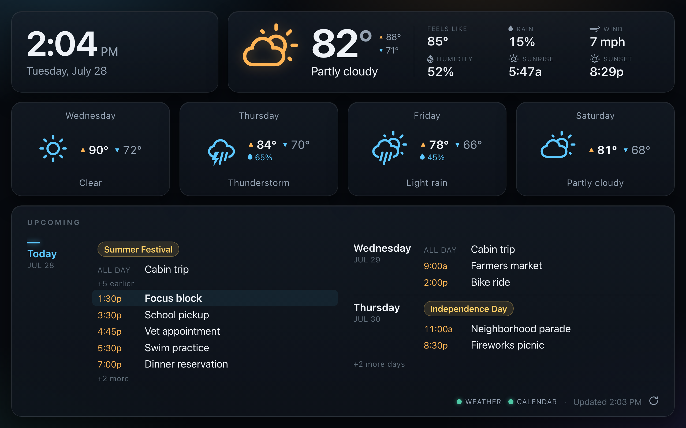
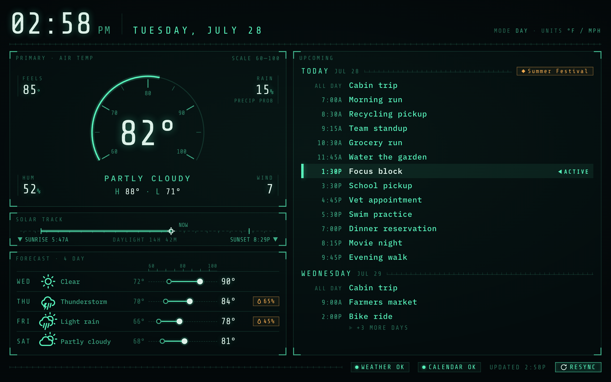
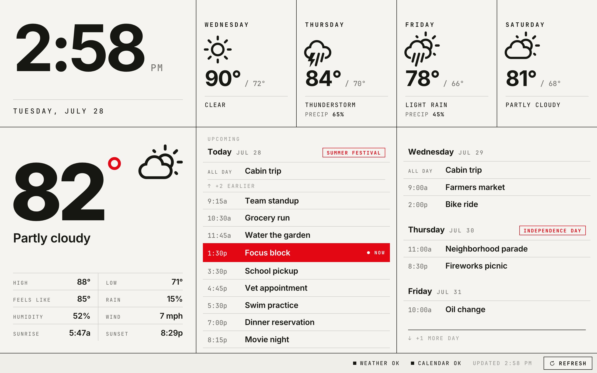
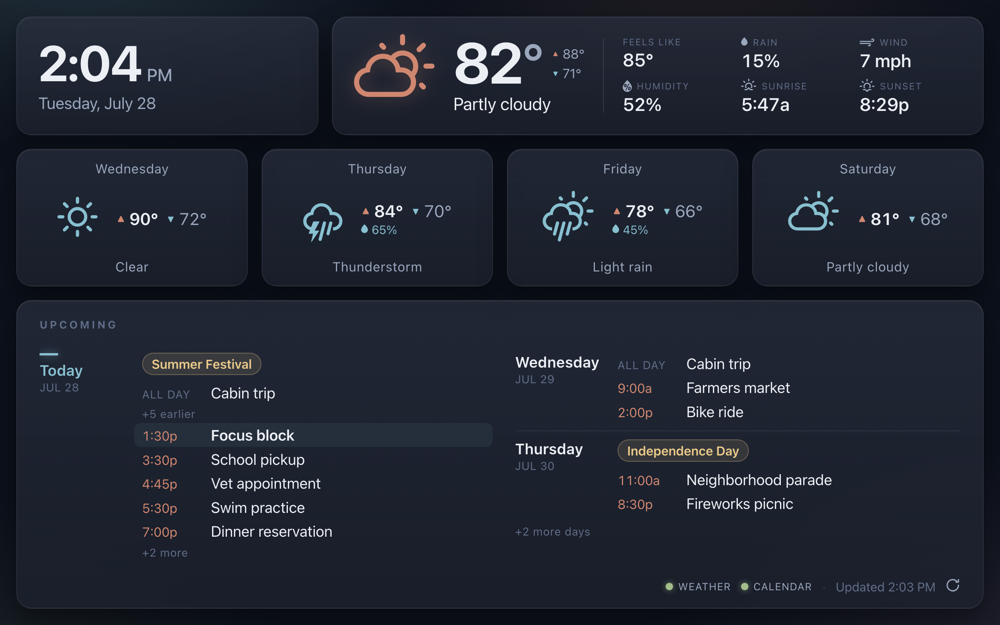
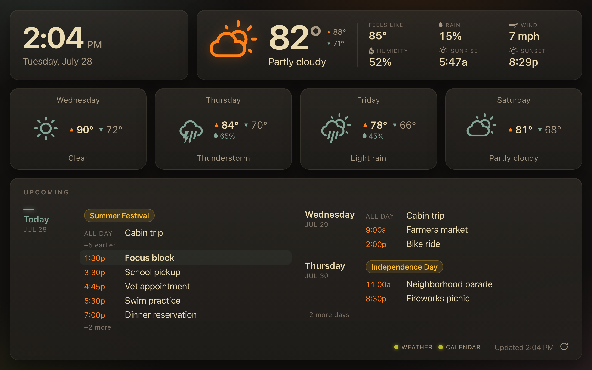
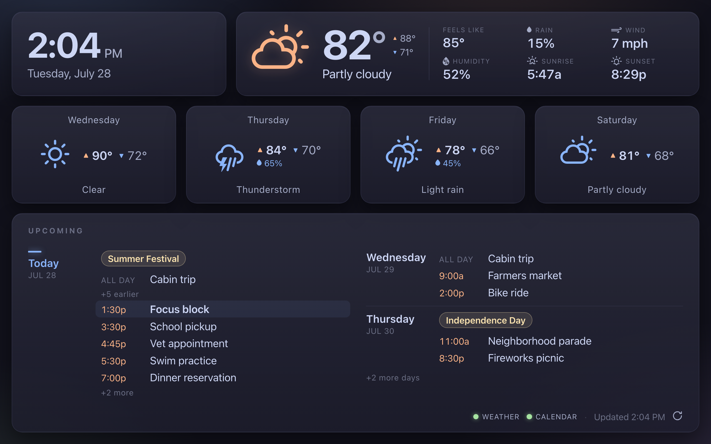
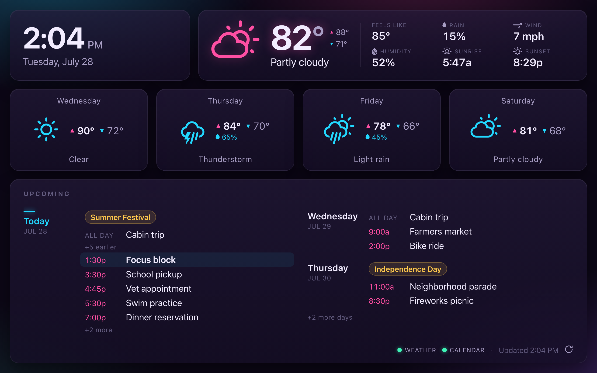

# pi-dashboard

A weather & calendar dashboard for a wall-mounted Raspberry Pi 5 touchscreen
(Pi OS Lite + labwc + Chromium kiosk). A FastAPI backend serves a static
dashboard that the on-Pi Chromium kiosk shows over `http://localhost`.



*Rendered by the real app from fabricated sample data - `tools/mockup.py` injects
a fixture cache into a locally-run server and screenshots it headless. No live
fetch, no real calendar.*

## What it shows

- **Current conditions** hero - Open-Meteo by default, optionally overlaid with
  real NWS station observations (see [Weather sources](#weather-sources)).
- **Multi-day forecast** cards with a temperature range and an optional precip line.
- **Calendar agenda** from a Proton Calendar ICS feed: timed and all-day /
  multi-day events, an in-progress "next up" highlight, roll-off of past events
  ("+N earlier"), and overflow collapsing ("+N more", "+N more days").
- **Holidays / observances** as inline pills.
- **Live clock** and hands-off refresh - a background loop repolls weather and
  calendar, and the UI rolls over at midnight on its own.
- **Selectable look** - swap the [layout](#layouts), [theme](#themes), and
  [icon pack](#icon-packs) independently, all env-driven.
- **On-device admin screen** - a keyboard-less [admin overlay](#admin-screen)
  reached from the footer cog.

## Requirements

- Python 3.13.5 (pinned via `.python-version`; provisioned by `uv`)
- [`uv`](https://docs.astral.sh/uv/) for dependency / venv management
- Node (dev-only, for `tsc` and JS tests; pinned via `.tool-versions`, provisioned by `mise`)

## Setup

```sh
uv sync                  # create the venv, install deps from uv.lock
cp .env.example .env      # then edit it - see Configuration and Secrets below
```

## Run

```sh
uv run uvicorn app.main:app --reload    # dev (Mac): http://127.0.0.1:8000
```

`/` serves the static dashboard (with `Cache-Control: no-cache`, so a deploy's new
bundle loads instead of a stale copy), `/api/data` serves the normalized
weather/calendar contract the dashboard polls, and `/healthz` returns
`{"status": "ok", "boot": "<id>"}` (`boot` changes on every process start). For production on the Pi, see [Deploy](#deploy-pi).

## Configuration

Three independent settings select the look - `LAYOUT`, `THEME`, and `ICON_PACK`,
each naming a directory under `static/`. They're set in `.env` and read **at
backend startup**, so a change needs `systemctl --user restart
pi-dashboard.service`, not just a browser reload (or use **Apply** on the
[admin screen](#admin-screen), which does both). All three **fail soft**: an
invalid or missing value falls back to the default instead of blanking the kiosk.
The [weather source](#weather-sources) is configured here too (`NWS_STATION`,
`WEATHER_MODEL`).

### Layouts

`LAYOUT=<name>` picks the UI from `static/layouts/`:

- `classic` (default) - the production bento-over-ambient-glow UI.
- `hud` - an instrument-HUD design (240° temperature dial, solar day-tape,
  forecast range plot), using self-hosted subset mono fonts under
  `static/vendor/fonts/`.
- `swiss-mono` - a swiss-grotesque "exposed grid" paper design (Inter + JetBrains
  Mono). A **fixed light** layout: its palette is layout-local, so unlike
  classic/hud it does not respond to THEME.

Preview against the mockup fixture without touching `.env`:

```sh
uv run python -m tools.mockup --layout hud          # -> docs/mockup-hud.png
uv run python -m tools.mockup --layout hud --serve  # browse it live instead
```

| `classic` (default) | `hud` | `swiss-mono` |
| --- | --- | --- |
|  |  |  |

### Themes

The palette lives in `:root` custom properties in `static/style.css` (every tint
and glow is `color-mix()`-derived from them), so a theme is just a `:root` override
block in `static/themes/<name>.css` - see `static/themes/nord.css` for the
contract. `THEME=<name>` links it at `/theme.css`, after `style.css` so it wins the
cascade.

LAYOUT and THEME are independent: a hue theme (`nord` / `gruvbox` / `catppuccin`)
retints whichever layout is active. Two exceptions: `synthwave` also boosts the
glows and adds a neon hero `text-shadow` through classic-layout selectors, so its
effects only fully apply to `classic`; and `swiss-mono`'s palette is layout-local,
so it ignores THEME.

```sh
uv run python -m tools.mockup --theme nord          # -> docs/mockup-nord.png
uv run python -m tools.mockup --theme nord --serve  # browse it live instead
```

| `nord` | `gruvbox` | `catppuccin` | `synthwave` |
| --- | --- | --- | --- |
|  |  |  |  |

### Icon packs

`ICON_PACK=<name>` picks the weather-icon set from `static/packs/`. It maps every
condition (and the chrome glyphs - wind / humidity / precip / sunrise / sunset)
through the selected pack, whatever layout or theme is active:

- `weather-icons` (default) - the vendored weather-icons font; glyphs drawn in the
  text color.
- `meteocons-flat` / `meteocons-line` - full-color vendored Meteocons SVGs, filled
  or outline style.
- `meteocons-mono` - single-color Meteocons, painted as a CSS mask over
  `currentColor`, so it inherits the layout/theme text color (the only pack that
  retints with the palette).

**Adding a pack.** A directory `static/packs/<name>/` with two files:

- `index.js` exporting `iconPack` (an `IconPack` per `static/core/contract.js`)
  whose `renderIcon(name, extra)` returns `<i class="wx-icon wx-<name> <extra>">`.
  It's byte-identical across packs - the token-to-asset map lives in the CSS.
- `pack.css` - a `.wx-icon` base rule plus one `.wx-<name>` rule per semantic name,
  mapping each token to its asset (font glyph, SVG `url()`, or mask).

Then register `<name>` in `tests/test_pack.py`'s `_BUNDLED_PACKS`. The bundled
packs' `pack.css` is generated from a Python map under `app/packs/`
(`weather_icons.py`; the three Meteocons variants share `meteocons.py`), and a test
fails if the committed file drifts from it - regenerate, don't hand-edit. A new
pack can hand-write its `pack.css` instead. Licensing is under
[Attribution](#attribution).

### Weather sources

Conditions and forecast default to [Open-Meteo](https://open-meteo.com/) (no key
needed). Set `NWS_STATION=<station id>` to overlay real
[National Weather Service](https://www.weather.gov/) station observations on the
hero's current conditions - a measurement instead of a model estimate. US-only, off
by default, fail-soft: any NWS hiccup falls back to the pure Open-Meteo hero for
that refresh, and the forecast cards always stay Open-Meteo. See `.env.example` for
finding your nearest station and the `NWS_USER_AGENT` contact-info note. The
Open-Meteo forecast model is selectable via `WEATHER_MODEL` (default `best_match`).

## Admin screen

The wall has no keyboard, so its controls live on-screen. Tap the **cog** at the
bottom-left of the dashboard to open the admin screen; tap the **back arrow**
(top-left) to return. It is an overlay: the dashboard keeps ticking and polling
underneath, so it is current the moment you return. A reload or cold boot always
lands on the dashboard, never on admin.

The admin screen edits `LAYOUT`, `THEME` and `ICON_PACK` on-device, shows device
health, and offers restart / reboot. Each setting lists only the values installed
under `static/`. Tap values to stage them, then **Apply**: the backend rewrites
just those lines of `.env` (everything else, including `PROTON_ICS_URL`, is left
untouched) and restarts `pi-dashboard.service` about a second later via a
`systemd-run --user` timer. The wall reloads onto the new skin once the new
process answers `/healthz`; if that takes over ~120s it says so and stays on
admin. On a dev Mac (no `systemd-run`) the `.env` write still happens but the
restart fails, so restart the server by hand.

**Device health** refreshes every 5s while admin is open (and stops when you
leave): CPU, RAM, disk, uptime, host, and network (IPv4 address, prefix, and
interface) via `psutil`, plus temperature and throttle state from `vcgencmd` on
the Pi. Throttle shows named flags (under-voltage, throttled, ...) marked "now"
or "earlier" since boot, with the raw `get_throttled` hex beside them; healthy is
`0x0`. Any field whose source is missing reads "unavailable" on its own - on a
dev Mac that is always temperature and throttle.

**Device actions** - **Restart dashboard** and **Reboot Pi** - each take two
taps: the first opens a confirm dialog, the second fires, so a stray touch can't
drop the wall. Restart uses the same detached restart as Apply and reloads once
the new process answers. Reboot asks logind over D-Bus (`busctl`) without a
password prompt, which needs the one-time polkit rule in
`deploy/49-pi-dashboard-reboot.rules` (install steps in `deploy/README.md`).
Without the rule - or off-Pi - Reboot shows "unavailable", and the wall never
says "Rebooting..." unless logind actually accepted the reboot.

It is **layout-aware but theme-independent**: each layout can ship its own admin
skin as `static/layouts/<name>/admin.js` + `admin.css` (falling back to classic's),
and its palette is scoped to the overlay so `THEME` never restyles it.

## Frontend architecture

The dashboard is a small ES-module graph, not one script - three layers, each with
one job:

- **Server routes** (`app/main.py`) pick the skin from config and serve it:
  `/theme.css` (THEME), `/layout.css` + `/layout.js` (LAYOUT), `/pack.js` +
  `/pack.css` (ICON_PACK), `/admin.js` + `/admin.css` (LAYOUT's admin skin),
  `/api/admin/config` (the admin knobs; writes go through `app/envfile.py` and
  the restart through `app/service.py`), `/api/admin/stats` (device health,
  `app/stats.py`), `/api/admin/restart` + `/api/admin/reboot` (device actions,
  `app/service.py`), and the no-cache static mount.
- **Layout-agnostic core** (`static/core/`) owns *when* to render: `machine.js` is
  the fetch / 15-min poll / 30-s retry / midnight-rollover / live-clock state
  machine; `router.js` is the hash router overlay screens mount into, and
  `admin.js` the admin controller (behavior only - the skin renders), with
  `admin-panels.js` the panel markup every admin skin shares;
  `contract.js` mirrors the backend data contract as JSDoc typedefs;
  `time.js` / `agenda.js` / `format.js` / `dom.js` are the pure helpers.
- **Per-layout modules** (`static/layouts/<name>/`) own *what* renders and all their
  own DOM/CSS. A layout is an ES module exporting a `layout` object that implements
  the `Layout` interface (`static/core/contract.js`): `mount`,
  `renderClock`, `renderCurrent`, `renderForecast`, `renderAgenda`, `renderStatus`,
  `renderUnavailable`.

`static/app.js` is a thin bootstrap: it imports the core state machine and the
layout (via `/layout.js`, a generated re-export of the selected module) and calls
`createApp(layout).init()`. The mount is wrapped so a layout that throws can't
blank the kiosk.

## Deploy (Pi)

Production runs on the Pi as systemd user services (backend + labwc + Chromium
kiosk) plus root-level system config. See [`deploy/README.md`](deploy/README.md)
for the storage decision, install steps, quiet-boot tokens, and the on-Pi
acceptance checklist.

## Test / lint

The JS tests and `tsc` need Node ≥18 (dev-only: there's no build step, and the ES
modules are served as-is).

```sh
uv run pytest
uv run ruff check .
uv run ruff format .
uv run mypy                                        # strict (app + tests)
npx -y -p typescript tsc -p static/jsconfig.json   # type-check the frontend against the JSDoc contract
(cd static && node --test)                         # JS unit tests
```

## Secrets & data handling

`PROTON_ICS_URL` is the Proton Calendar "Full view" ICS link. **The URL embeds the
decryption key inline**, so it is both a credential and a source of calendar PII
(event titles, descriptions, participants, locations). Put it only in the
git-ignored `.env` - never commit it, echo it into logs or shell history, or share
it.

## Attribution

Weather data by [Open-Meteo.com](https://open-meteo.com/), licensed under
[CC BY 4.0](https://creativecommons.org/licenses/by/4.0/). When `NWS_STATION` is
set, current conditions come from the
[National Weather Service](https://www.weather.gov/) (US-government public domain).

Icons: the weather-icons font is under the
[SIL Open Font License](https://openfontlicense.org/)
(`static/vendor/weather-icons/OFL.txt`); the Meteocons SVGs are under the MIT
License, Copyright (c) 2020-present Bas Milius
(`static/packs/meteocons/LICENSE-MIT.txt`). Both are vendored offline (Meteocons
via `tools/vendor_meteocons.py`), so the running Pi makes no network calls for
icons.
